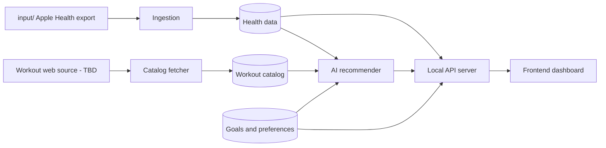

# Project goals

The product's purpose, target state and open decisions. **Orchestrator:** read this in the *Understand* step (`.agents/orchestrator.md`). Check each request against the constraints below. Ask the user about anything listed under *Open decisions* instead of assuming.

[`v1-spec.md`](v1-spec.md) holds the original acceptance criteria for v1 (a client-only dashboard). This file describes where the project is going.

## Purpose

Read the user's Apple Health export (copied into `input/`) and show it in a dashboard that helps them understand their health, set weight goals, and follow workout routines suited to them.

## Constraints

- **Runs locally.** Frontend and backend run on the user's machine. No hosting, no accounts.
- **Single user**: the owner of the health export.
- **Health data stays local.** Nothing from `input/` or `public/data/` leaves the machine, except the minimum an approved web or AI call needs. The user must approve what is sent (see `AGENTS.md` › Boundaries).

## Features

The app has three tabs.

### 1. Health & Activity Metrics
- **Goal:** main dashboard showing the imported health data as charts: weight/BMI, steps, energy, heart rate and VO2 max, workout mix, and sleep, with timeline filters.
- **Current state:** implemented (`src/components/tabs/HealthMetricsTab.tsx`).

### 2. Weight Goals & Routine Recommendation
- **Goal:**
  - The user sets a weight goal and a timeframe, and **tracks progress** against it using imported weigh-ins.
  - The user chooses how many days per week they want to work out, and the app suggests workouts to reach the goal.
  - **Suggestions come from the backend**, which builds them from a fetched workout catalog plus an AI recommendation tailored to the user's data and goal.
- **Current state:**
  - Goal form, deficit and safety analysis, projected trajectory chart and routine table exist (`src/components/tabs/WeightGoalPlannerTab.tsx`).
  - Suggestions come from a hardcoded **client-side** engine (`src/services/recommendationEngine.ts`, `evaluateWeightGoalAndRecommendRoutine`).
  - There is no actual-vs-goal progress tracking, and the goal isn't persisted.

### 3. Workout History & GPX Route Explorer
- **Goal:** the user's workout history (filterable and sortable), with GPS routes on a map.
- **Current state:**
  - Implemented (`src/components/tabs/WorkoutsRoutesTab.tsx`).
  - Known gap: `routePath` is `null` for every workout, so routes aren't linked to their workouts.

## Backend: multiple processes

The backend is not a single program. The **backend role owns all of these processes**:

| Process | Purpose | Status |
|---|---|---|
| Health data ingestion | Stream-parse `input/` → `public/data/*.json` (`scripts/parse_health_data.py`) | exists |
| Local API server | Serve health data, goals, progress and recommendations to the frontend | planned |
| Workout catalog fetcher | Fetch workout plans and exercises from a web source; store them locally | planned (source TBD) |
| AI recommender | Combine health data, the goal, days per week and the catalog into a suggested routine | planned (provider TBD) |

Target flow:

The frontend⇄backend interface is defined in `.agents/contracts/data-contract.md`: today the JSON files, and the API once it exists.

## Roadmap

Do these in order. Each step should leave the app working.

1. **Local API server.** Serve the existing data, and add the API section to the data contract.
2. **Move recommendations behind the API.** Port the current engine to the backend, and keep the client engine as an offline fallback until the API path is verified.
3. **Goal persistence and progress tracking.** Store the goal, and chart actual weigh-ins against it in tab 2.
4. **Workout catalog fetcher.** Needs the web source decided (see open decisions).
5. **AI recommender.** Needs the provider and the data-sharing scope decided. Use the catalog as its source of exercises.

Fixing the route linkage (tab 3) is independent and can be done at any time.

## Open decisions

The orchestrator asks the user about these. It doesn't decide them.

- **Workout web source:** which site or API to fetch plans and exercises from, and whether its terms allow it.
- **AI provider and model**, and exactly which health fields may be sent to it (aggregates only vs raw).
- **Backend language and framework.** Default: Python, to match the parser.
- **Storage** for goals, the catalog and recommendation history (e.g. JSON files vs SQLite).
- **API style** (e.g. REST/JSON) and how the frontend dev server reaches it (Vite proxy).
