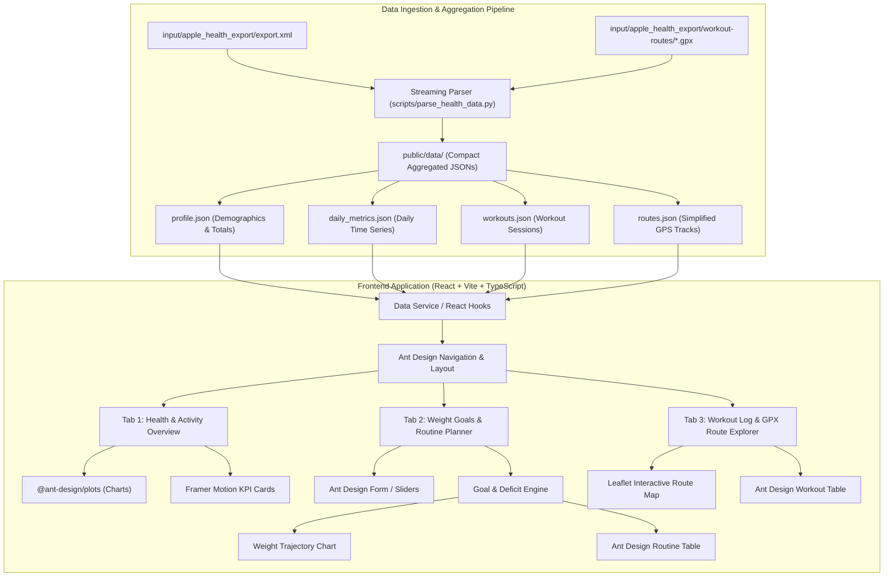

# Fitness Tracker Dashboard — Implementation Plan

This document outlines the architecture, data processing pipeline, and step-by-step implementation plan for the Fitness Tracker Dashboard based on [`v1-spec.md`](v1-spec.md) and the Apple Health dataset in the `input/` directory.

---

## 1. Project Overview & Objectives

### 1.1 Acceptance Criteria (from `v1-spec.md`)
- **AC-1 (Metrics Graphics)**: The dashboard displays all relevant health and fitness metrics as interactive graphics from the dataset files.
- **AC-2 (Weight Goal & Routine Recommendation Navigation Tab)**: The dashboard includes a dedicated navigation tab where users can configure their weight goals and timeframe. Based on the user's historical health data, goals, and target timeline, a personalized exercise routine is recommended.
- **AC-3 (Recommended Routine Table)**: The recommended routine is rendered in an organized, interactive table.
- **AC-4 (Technology Constraints)**:
  - HTML, React, TypeScript, CSS.
  - Ant Design (`antd`) UI components.
  - Framer Motion for smooth animations and transitions.
  - Ant Design Charts (`@ant-design/plots`) for metric visualizations.
  - Leaflet / React-Leaflet for interactive GPX workout route visualization.

---

## 2. Input Dataset Analysis

The `input/` folder contains comprehensive Apple Health export data:
- **`input/apple_health_export/export.xml`** (very large: hundreds of MB, millions of records):
  - **User Demographics**: biological sex, date of birth, blood type (from the `Me` element).
  - **Body Metrics**: Body Mass (Weight in kg), Lean Body Mass, Body Mass Index (BMI).
  - **Daily Activity & Energy**: Step count, Distance walking/running, Active energy burned, Basal energy burned, Flights climbed, Stand time, Exercise time.
  - **Cardiovascular & Vitals**: Continuous Heart Rate, Resting Heart Rate, Walking Heart Rate Average, Heart Rate Variability (SDNN), VO2 Max, Respiratory Rate.
  - **Mobility & Gait**: Walking speed, step length, walking asymmetry, double support percentage.
  - **Sleep & Wellness**: Sleep analysis stages, time in daylight, environmental audio exposure.
  - **Workouts**: Walking, Functional Strength Training, High-Intensity Interval Training, Mixed Metabolic Cardio, Running, Cross Training, etc.
- **`input/apple_health_export/workout-routes/*.gpx`**:
  - GPS tracks containing latitude, longitude, elevation, timestamps, speed, and course data for outdoor workouts.
- **`input/apple_health_export/export_cda.xml`**:
  - Clinical Document Architecture (CDA) vitals and records.

---

## 3. System Architecture



---

## 4. Phase-by-Phase Implementation Plan

### Phase 1: Project Setup & Tooling
1. Initialize the Vite project with React and TypeScript in the root workspace:
   ```bash
   npm create vite@latest . -- --template react-ts
   ```
2. Install required dependencies:
   - **UI & Icons**: `antd`, `@ant-design/icons`
   - **Charts & Maps**: `@ant-design/plots`, `leaflet`, `react-leaflet`, `@types/leaflet`
   - **Animations**: `framer-motion`
   - **Utilities**: `dayjs`
3. Configure `vite.config.ts`, `tsconfig.json`, and global styling with Ant Design themes and modern CSS variables.

### Phase 2: Data Extraction & Pipeline (`npm run parse-data`)
To ensure optimal performance and eliminate browser memory issues with the very large XML file, create an efficient streaming parser script (`scripts/parse_health_data.py` or Node equivalent) and register `npm run parse-data`:
- **Output files in `public/data/`**:
  - `profile.json`: Biological sex, birth date, age, current weight, latest BMI, total recorded workouts, total active calories burned, date range.
  - `daily_metrics.json`: Chronological array by date (`YYYY-MM-DD`):
    - Steps, distance (km), active calories (kcal), basal calories (kcal), total energy expenditure (TDEE).
    - Resting heart rate (bpm), VO2 max, HRV (ms), average walking heart rate.
    - Body weight (kg), BMI, lean mass (kg).
    - Sleep duration (hours), exercise minutes.
  - `workouts.json`: Array of workout sessions:
    - ID, activity type, start/end time, duration (minutes), total distance (km), total energy burned (kcal), average heart rate, route reference ID.
  - `routes.json`: Simplified GPS route polyline coordinates, elevation gain, pace, and bounding boxes for map rendering.

### Phase 3: Dashboard Navigation & Health Metrics Graphics (Tab 1)
1. **Header & Navigation Bar**:
   - Application logo, user profile summary tag, date range selector (All time, 1 Year, 6 Months, 30 Days, Custom Range).
   - Ant Design `Tabs` for seamless view switching.
2. **KPI Summary Cards (Animated via Framer Motion)**:
   - Current Weight & BMI status.
   - Average Daily Steps & Trend indicator.
   - Resting Heart Rate & VO2 Max fitness score.
   - Average Daily Active Caloric Burn.
3. **Interactive Charts (`@ant-design/plots`)**:
   - **Body Weight & Composition**: Dual-axis line/area chart showing Weight (kg) and BMI changes over time.
   - **Daily Activity & Energy**: Area/column charts showing steps, active calories burned vs daily baseline.
   - **Cardiovascular Health**: Multi-line trend chart of Resting Heart Rate, Walking Heart Rate, and VO2 Max.
   - **Workouts Breakdown**: Donut / Rose chart showing distribution of workout types (Walking, Strength, HIIT, Running).
   - **Sleep & Recovery**: Bar chart showing nightly sleep duration and trends.

### Phase 4: Weight Goal & Routine Recommendation Engine (Tab 2)
1. **Interactive Goal Configuration**:
   - Initial values auto-populated from user's latest health data:
     - Current Weight: latest imported weigh-in (user editable).
     - Target Weight (kg).
     - Target Timeframe (weeks / months or target date picker).
     - Weekly Workout Days commitment (e.g. 3 to 6 days/week).
     - Preferred Training Focus (Balanced, Cardio-focused, Strength & Hypertrophy, High Caloric Burn).
2. **Recommendation & Health Algorithm**:
   - **Target Deficit**: Total weight to lose/gain $\times 7,700\text{ kcal/kg}$ fat mass equivalent.
   - **Weekly Rate**: $(\text{Current Weight} - \text{Target Weight}) / \text{Target Weeks}$.
   - **Daily Deficit Required**: $(\text{Weekly Weight Loss in kg} \times 7,700) / 7\text{ kcal/day}$.
   - **Safety & Feasibility Verification**:
     - *Safe/Sustainable*: $\le 0.75\text{ kg/week}$ (Deficit $\le 825\text{ kcal/day}$).
     - *Moderate*: $0.75\text{ kg} - 1.0\text{ kg/week}$ (Deficit $825 - 1,100\text{ kcal/day}$).
     - *Aggressive/Unrealistic Warning*: $> 1.0\text{ kg/week}$. Provides warning and recommended healthy duration adjustment.
   - **Personalized Routine Generator**:
     - Tailors exercises to match the user's recorded workout history (Walking, Functional Strength Training, HIIT, Running) while progressively increasing intensity/volume to fulfill the required active calorie deficit.
3. **Output Presentation**:
   - **Feasibility Alert / Badge**: Ant Design `Alert` with nutritional deficit breakdown and coaching guidance.
   - **Projected Weight Curve Chart**: Projected trajectory from current weight to target weight over the planned weeks.
   - **Recommended Routine Table (Ant Design `Table`)**:
     - **Columns**: Day of Week, Workout Session / Focus, Exercise Details, Target Duration (mins), Target Intensity / Heart Rate Zone, Volume (Sets $\times$ Reps / Distance), Est. Calories Burned, Form & Recovery Coaching Notes.
     - Interactive row expansion or modal for detailed exercise instructions.
     - Export to PDF or Print option.

### Phase 5: Workouts & GPX Route Explorer (Tab 3)
1. **Workout Catalog**: Filterable Ant Design `Table` of all historical workouts with search by type, date, duration, and calories.
2. **Interactive Route Map (`react-leaflet`)**:
   - OpenStreetMap base layer.
   - GPS polyline with start/finish markers.
   - Elevation and pace profile graph corresponding to the selected route.

### Phase 6: Polishing, Responsiveness & Verification
1. Ant Design dark/light mode and responsive layouts for mobile and desktop screens.
2. Framer Motion page transitions and hover animations.
3. Full TypeScript type safety and linting verification.
4. Production build test (`npm run build`).

---

## 5. Acceptance Verification Checklist
- [ ] Raw Apple Health files in `input/` successfully parsed and summarized.
- [ ] Dashboard displays health data as graphics (steps, weight, heart rate, sleep, workouts).
- [ ] Navigation tab provides weight goal and target timeframe inputs.
- [ ] Personalized routine is dynamically computed from user health data and goals.
- [ ] Recommended routine is displayed as an Ant Design table.
- [ ] UI built with React, TypeScript, Ant Design, `@ant-design/plots`, and Framer Motion.
- [ ] Interactive GPX route map for outdoor workouts.
